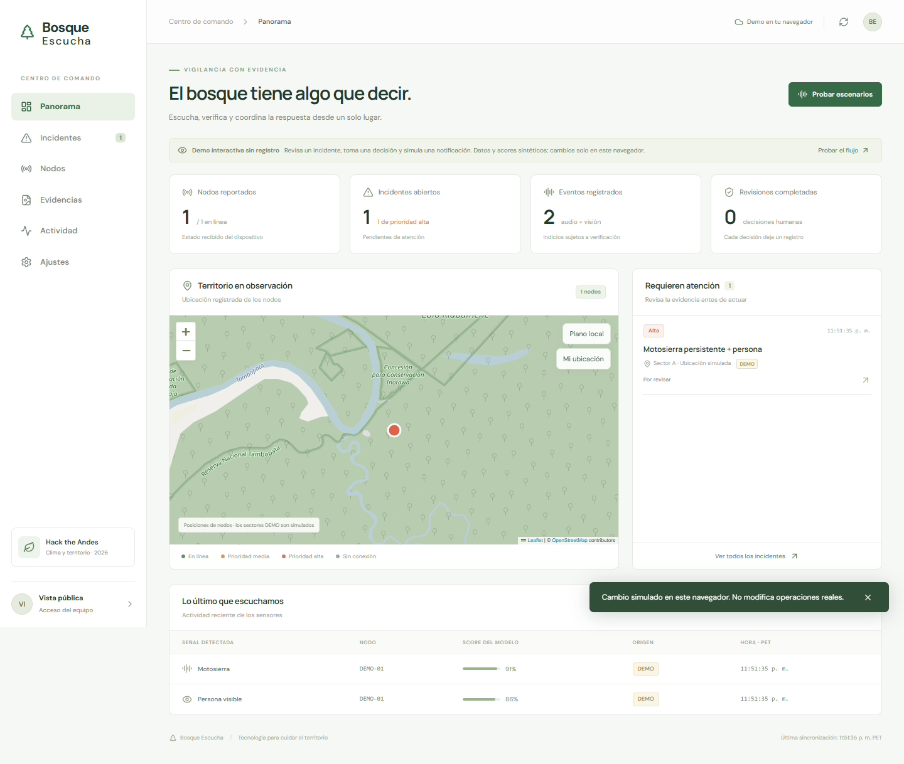
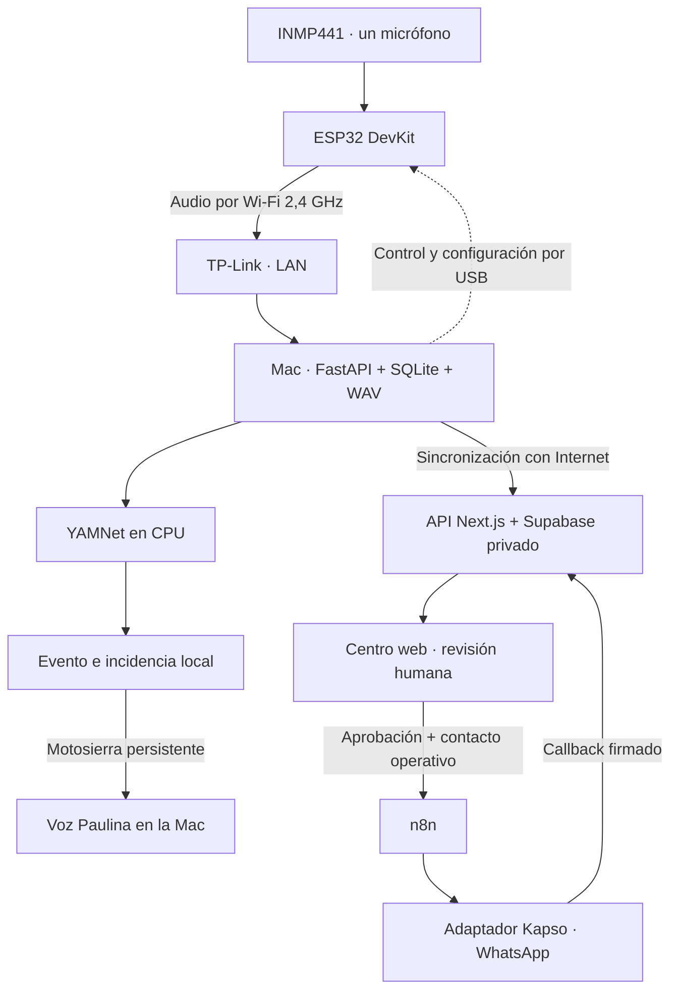

# greenear · Bosque Escucha

**Un micrófono en el territorio, evidencia en el centro de comando y revisión humana antes de avisar por WhatsApp.**

MVP de Hack the Andes 2026 · Clima y Territorio. Estado documentado: **18 de octubre de 2026**.

[Producto público](https://bosque-escucha.vercel.app) · [Landing y presentación](https://bosque-escucha-landing.vercel.app) · [Issues y próximos pasos](https://github.com/asther0/gatitos-fbi--bosque-escucha/issues)

La entrega del equipo **gatitos_fbi** quedó registrada por el CLI del concurso el 18 de octubre a las **08:58:43, hora de Lima**, con la landing como presentación.

## Qué tenemos

El montaje actual utiliza **un ESP32 DevKit con un micrófono INMP441**. Captura audio y lo envía por Wi-Fi a una Mac mediante un router TP-Link. La Mac ejecuta YAMNet, guarda la grabación y registra indicios compatibles con motosierra. Una detección persistente crea una incidencia y solicita una alerta hablada con la voz **Paulina de macOS**.

El centro web permite revisar evidencia privada, priorizar, asignar y cerrar incidencias. Al recuperar Internet, el centro local sincroniza con Supabase. La integración **n8n → Kapso → WhatsApp** cuenta con simulacros autorizados cuya entrega fue confirmada por callback firmado.

La IA se ejecuta en la laptop, **no en el ESP32**. La cámara ESP32-CAM quedó fuera de esta demostración. El código de visión y el receptor USB BESC se conservan como trabajo previo, pero no forman parte del recorrido físico actual. La voz local no usa ElevenLabs.

## Probar el MVP físico

En la Mac ya preparada, con modelos y muestra de sonido instalados:

1. Conecta el ESP32 por USB y cierra el monitor serial de Arduino.
2. Conecta la Mac a **TP-Link_275C**. El ESP32 debe estar en la misma red de 2,4 GHz. El aviso «Sin Internet» es compatible con esta prueba local.
3. Abre **[Iniciar MVP.command](Iniciar%20MVP.command)** con doble clic y deja su ventana abierta. Abre el panel en `http://127.0.0.1:8765` con acceso automático.
4. Pulsa **Activar escucha** para tomar clips de forma periódica. Si quieres comprobarlo con la muestra instalada, acerca el micrófono al altavoz y usa **Prueba manual → Probar motosierra**.
5. Revisa la hora y el resultado. Abre **Escuchar grabación y ver análisis** para comprobar la evidencia; las incidencias están en **Incidencias**.
6. Pulsa **Detener escucha** al terminar. El ESP32 no inicia la escucha por sí solo tras reiniciarse.

La escucha automática toma **clips de 3 segundos cada 5 segundos**; no es continua. USB proporciona alimentación y comandos de configuración/control en esta demo. El transporte del audio al centro es Wi-Fi.

El panel actualiza el destino del ESP32 si cambia la IP de la Mac y ambos están en la misma subred. Espera hasta 12 segundos si la Mac todavía no tiene una IP válida. Si continúa el error: **Ajustes → Wi-Fi → TP-Link → Detalles → TCP/IP → Renovar concesión DHCP**. La primera configuración de red y clave está en **Configurar Wi-Fi**.

El iniciador utiliza el entorno Python instalado; no descarga modelos ni muestras. Para preparar otra máquina, consultar la [guía del centro local](local-center/README.md) y el [firmware Wi-Fi](firmware/mic_wifi/README.md).

### Conexión del micrófono

En esta placa las etiquetas `D25`, `D26` y `D33` corresponden a GPIO 25, 26 y 33.

| INMP441 | ESP32 DevKit |
| --- | --- |
| VDD | 3V3 |
| GND | GND |
| L/R | GND |
| SCK | D25 |
| WS | D26 |
| SD | D33 |

## Qué se verificó

Las tres capturas del **18/10/2026** se recibieron bajo el nodo `DEMO-ESP32-WIFI`. Son WAV mono de 2 segundos a 16 kHz. Se reejecutó YAMNet sobre los archivos guardados y se reprodujeron los mismos puntajes y estados de persistencia, sin crear eventos adicionales.

| Hora de Lima | Puntaje de motosierra | Resultado guardado |
| --- | --- | --- |
| 09:04:55 | 0.926743 | Detección persistente; incidencia de prioridad media. |
| 09:05:24 | 0.0000246 | Sin detección objetivo; clase principal Speech. |
| 09:05:35 | 0.832134 | Detección sin persistencia; evento asociado a la incidencia existente. |

El umbral configurado es **0.65**. La persistencia exige **tres ventanas consecutivas dentro del mismo clip**. Los scores son salidas del modelo, no porcentajes de precisión. Estas pruebas respaldan el recorrido de laboratorio con audio reproducido y captado por el micrófono; no miden desempeño en bosque ni validan detección de pasos o incendios.

La incidencia local de esta prueba es `24085534-9d1a-43a4-9185-a75ec00a172a`. Se comprobó su presencia en `localhost:3000` y en Supabase del despliegue público. Hay que activar **Ver datos de prueba**: la vista operativa oculta IDs `DEMO-*`. La ficha muestra las dos grabaciones asociadas. El disparo de voz está implementado; el registro de una detección no acredita por sí solo que el altavoz haya sido audible.

| Componente | Evidencia disponible |
| --- | --- |
| ESP32 + INMP441 | Captura física y recepción HTTP por TP-Link; firmware Wi-Fi protocolo 2 cargado. |
| Centro local | Panel con botones, WAV privado, análisis, SQLite, incidencia y cola de sincronización. |
| Centro web + Supabase | Incidencia del micrófono sincronizada; revisión humana y evidencia privada. |
| Mapa | Nodos con coordenadas; geolocalización del navegador y capa de puntos simulados. |
| Asistente n8n | Webhook autenticado y respuesta real de GPT-4o-mini verificadas; [reporte](integrations/n8n/live-assistant/REPORT.md). |
| WhatsApp | Dos simulacros autorizados entregados mediante n8n/Kapso; [registro técnico](integrations/n8n/KAPSO.md). |
| Pruebas de controles locales | Ocho pruebas de autorización, coordinación captura/reproducción, cambio de IP y espera DHCP. Serial simulado, separado de las pruebas físicas. |

## Dónde ver la incidencia y cuándo llega WhatsApp

| Interfaz | Fuente de datos y conectividad |
| --- | --- |
| `127.0.0.1:8765` | Centro FastAPI de la Mac: capturas e incidencias locales, disponible sin Internet. |
| `localhost:3000` | Centro web Next.js de desarrollo: consulta Supabase; requiere Internet para datos cloud. |
| [Centro publicado](https://bosque-escucha.vercel.app) | Centro web desplegado: datos de Supabase con acceso de operador. |

En el centro web, entra como operador y pulsa **Ver pruebas del ESP32** para incluir `DEMO-ESP32-WIFI`. La vista operativa lo oculta por defecto, pero indica cuántas incidencias del micrófono ya se sincronizaron; la elección de mostrar pruebas se conserva en ese navegador. El nodo de esta prueba todavía no tiene coordenadas registradas: una incidencia sincronizada no basta para dibujarlo en el mapa. **Mi ubicación** muestra la posición del navegador; no la asigna automáticamente al sensor. Registrar y validar la posición del dispositivo antes de usar el mapa como referencia territorial. Los cinco puntos simulados representan otras zonas de escucha, no dispositivos físicos adicionales.

La detección local y la sincronización **no envían WhatsApp automáticamente**. La cola offline conserva y reintenta evidencia e incidencias cada 15 segundos cuando vuelve Internet; no almacena una orden de WhatsApp. Para esta captura física de prueba, abre la incidencia sincronizada, añade una nota, pulsa **Verificar** y luego **Enviar simulacro por WhatsApp**. El servidor solo permite ese envío al destinatario de prueba autorizado y marca el texto **SIMULACRO · NO ES UNA ALERTA REAL**. Cada incidencia admite una sola reserva de envío. Los escenarios sintéticos siguen bloqueados. En **Actividad**, `queued` o aceptación de n8n no equivalen a entrega; `delivered` requiere el recibo firmado de Kapso. Para alertas operativas fuera del simulacro, se requiere contacto acordado para el sector y aprobación del operador. Para encolar también la decisión de enviar mientras no hay Internet, seguir [este issue](https://github.com/asther0/gatitos-fbi--bosque-escucha/issues/8).

Los simulacros de Kapso usaron contactos temporales que después se desactivaron. El proveedor vigente es Kapso; Zavu corresponde al intento anterior. La preparación del uso operativo se sigue en [el issue de WhatsApp](https://github.com/asther0/gatitos-fbi--bosque-escucha/issues/4).

## Explorar la entrega pública

Abre **[greenear](https://bosque-escucha.vercel.app)** y pulsa **Probar el flujo**. La demo pública no requiere contraseña: permite explorar incidentes y simular decisiones en la memoria del navegador. No modifica operaciones reales ni envía mensajes. Los datos operativos requieren la contraseña de operador, compartida por el equipo de forma privada.

La **[landing](https://bosque-escucha-landing.vercel.app)** sirve como presentación: explica el problema, muestra la plataforma y recoge conversaciones iniciales sobre la propuesta. Esas conversaciones no acreditan uso sostenido ni impacto medido en campo.

### Capturas del producto

Capturas reales de la interfaz pública con **datos sintéticos DEMO**; no representan detecciones de campo. [Procedencia](landing/capturas/LEEME.md).



[Lista de incidentes](landing/capturas/incidentes.png) · [Detalle de una incidencia](landing/capturas/ficha-incidente.png)

## Arquitectura



El centro local conserva evidencia y tareas en disco. La sincronización usa UUID estables y almacenamiento privado. Las capturas fallidas no se almacenan en el ESP32 para reintento. Cloud, cartografía externa y WhatsApp requieren Internet; análisis y revisión locales no lo requieren una vez instalados los modelos.

Los modelos aportan indicios para revisar; no identifican a una persona ni determinan ilegalidad. El acceso actual usa una contraseña compartida de operador y las evidencias se conservan sin borrado automático. El trabajo de piloto, calibración, retención y accesos se gestiona en [GitHub Issues](https://github.com/asther0/gatitos-fbi--bosque-escucha/issues).

## Desarrollo

Stack: **ESP32 / Arduino, INMP441, Python 3.11, FastAPI, TensorFlow/YAMNet, SQLite, Next.js 16, React 19, TypeScript, Supabase, Vercel, n8n y Kapso**.

### Ejecutar la web

Requiere Node.js 22 o posterior; el despliegue utiliza Node.js 24.

```bash
npm ci
# Solo en una instalación nueva, si no existe .env.local:
cp .env.example .env.local
# Completar las variables privadas del servidor.
npm run dev
```

En la Mac del equipo `.env.local` ya está configurado y excluido de Git: **no sobrescribirlo**. Las credenciales de operador, Supabase y proveedores no deben publicarse. Las migraciones están en `supabase/migrations/`; las tablas usan RLS y la evidencia un bucket privado.

### Verificación de software

```bash
npm run typecheck
npm run test:unit
npm run build
# Con el entorno Python del centro activado:
python -m unittest discover -s local-center -p test_mvp_controls.py
python local-center/smoke.py
python local-center/smoke_sync.py
python local-center/smoke_demo_guard.py
```

Los smoke locales usan datos temporales y servicios simulados. No acreditan entrega WhatsApp ni sensibilidad acústica. Para el smoke cloud, `node scripts/smoke-cloud.mjs` genera registros DEMO contra el servidor configurado.

### Módulos y documentación

| Módulo | Ruta |
| --- | --- |
| Inicio con un clic | [Iniciar MVP.command](Iniciar%20MVP.command) |
| Panel, ingesta, IA, evidencia y cola local | [local-center/](local-center/) |
| Firmware del montaje actual | [firmware/mic_wifi/](firmware/mic_wifi/) |
| Centro de comando y mapa | `components/`, `app/` |
| API, autorización y notificaciones | `app/api/`, `lib/` |
| Base de datos | `supabase/migrations/` |
| n8n y WhatsApp | [Integraciones](integrations/n8n/README.md) · [Kapso](integrations/n8n/KAPSO.md) |
| Contrato de API | [docs/API.md](docs/API.md) |
| Diseño original e historial de validación | [PRD](docs/Bosque_Escucha_PRD_MVP.md) · [Validación histórica](docs/VALIDACION.md) |
| Herramientas y sponsors | [docs/SPONSORS.md](docs/SPONSORS.md) |

El PRD y las validaciones del 17 de octubre describen etapas anteriores. Este README resume el montaje y las pruebas del 18 de octubre; los próximos pasos están organizados en issues.
