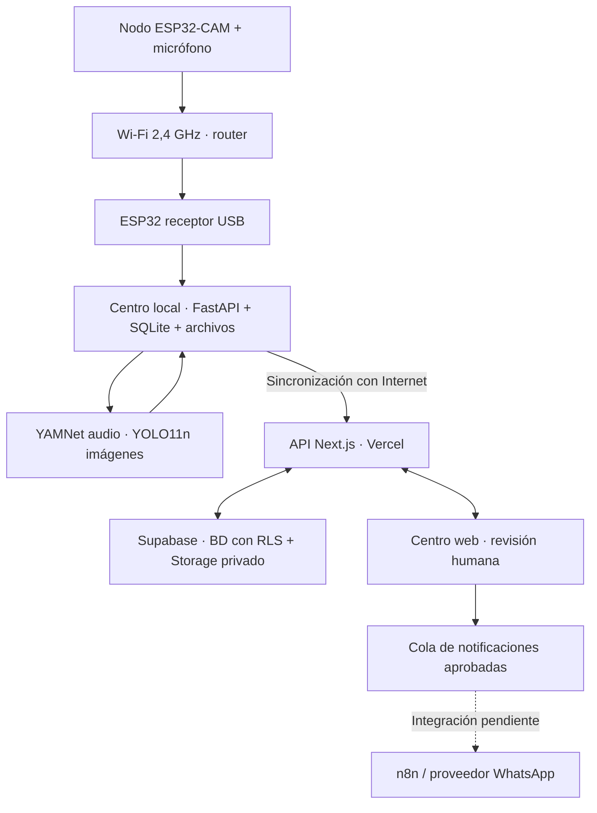

# greenear


**Vigilancia del bosque con evidencia acústica y visual, revisión humana y coordinación de inspecciones.**
Hack the Andes 2026 · Clima y Territorio

| Entrega | Enlace / estado |
| --- | --- |
| Landing | **[Conocer greenear](https://bosque-escucha-landing.vercel.app)** |
| Producto público | **[Abrir greenear](https://bosque-escucha.vercel.app)** |
| Presentación | **Pendiente:** publicar y agregar URL |
| Validación técnica | [Resultados y límites de las pruebas](docs/VALIDACION.md) |
| Especificación | [PRD en Markdown](docs/Bosque_Escucha_PRD_MVP.md) |

## Problema y usuario

Pensado para guardaparques, vigilantes comunitarios y responsables de conservación que necesitan revisar indicios de actividad en el bosque y decidir dónde inspeccionar. Un sonido aislado no basta para interpretar lo que ocurre: el operador necesita contexto, evidencia y un registro de su decisión.

greenear reúne audio e imágenes de nodos de campo, propone una prioridad y permite que una persona revise la evidencia antes de coordinar una respuesta. **La validación con usuarios reales del territorio está pendiente.**

## Cómo funciona

1. Un nodo con cámara y micrófono captura evidencia en el bosque.
2. El centro local conserva archivos y eventos; YAMNet analiza audio y YOLO11n busca personas en imágenes.
3. Las reglas relacionan indicios del mismo nodo para proponer una prioridad de revisión.
4. El operador escucha, observa, revisa el incidente y registra su decisión.
5. Con Internet, el centro sincroniza datos y evidencias con la web pública. Los datos operativos requieren acceso de operador.
6. Tras aprobación humana, una cola prepara la notificación. **La conexión externa n8n/WhatsApp está pendiente.**

Este es el flujo previsto del MVP. El tramo físico completo desde el nodo todavía no está validado; el estado de cada parte se detalla abajo.

## Probar desde la URL pública

Abrir **https://bosque-escucha.vercel.app**. La vista pública ofrece una **DEMO interactiva sin contraseña**. Pulsa **Probar el flujo** para revisar un incidente, cambiar prioridad, asignar, cerrar y simular una aprobación. Las decisiones quedan en la memoria del navegador y se reinician al recargar; no modifican operaciones reales ni envían mensajes. Los escenarios no incluyen capturas reales.

En el mapa, **Mi ubicación** solicita permiso al navegador y muestra tu posición con su margen de precisión. La posición se mantiene en el navegador y no se guarda como ubicación de un nodo.

Para revisar datos operativos y modificar incidentes reales se necesita la contraseña de operador, compartida por el equipo de forma privada. No se publica en este repositorio. La dirección `127.0.0.1:8765` corresponde al servicio de la laptop que procesa las capturas; **el enlace de entrega al jurado es la URL pública de Vercel**.

### Guion de demo · 3 minutos + 2 de preguntas

| Tiempo | Qué mostrar |
| --- | --- |
| 0:00–0:30 · Problema | Para quién se construye y qué decisión facilita: revisar evidencia y priorizar una inspección. |
| 0:30–2:30 · Producto en vivo | Abrir la URL pública, mostrar un incidente y su evidencia; probar una decisión simulada sin contraseña, o usar acceso de operador para un incidente real. Identificar cualquier dato sintético como DEMO. |
| 2:30–3:00 · Arquitectura | Explicar procesamiento local, persistencia offline, sincronización y revisión humana. Indicar qué integraciones siguen pendientes. |
| 3:00–5:00 · Preguntas | Responder sobre límites de los modelos, conectividad, privacidad y validación de campo. |

**Pendiente antes de presentar:** preparar un incidente con evidencia reproducible, ensayar el recorrido completo desde la URL pública. La captura física en vivo depende de resolver el enlace USB e integrar el nodo.

### Capturas del producto

**Pendiente:** agregar capturas reales del panorama con mapa, del detalle de un incidente con evidencia y de la decisión del operador. Deben ocultar secretos y datos personales, e identificar los datos DEMO. Las capturas acompañarán la explicación; la entrega incluye el producto funcionando desde su URL.

## Estado real del MVP

| Componente | Estado y evidencia |
| --- | --- |
| Centro web y Supabase | Desplegados; build, acceso a BD y smoke de API en producción verificados. |
| Incidentes y revisión humana | Persistencia, correlación, cambios de estado y conservación de prioridad humana verificados por API. |
| Evidencia privada | Subida, deduplicación y recuperación de WAV de control verificadas; acceso anónimo denegado. |
| Mapa | OpenStreetMap verificado en producción; plano esquemático disponible como respaldo. |
| Centro local y sincronización | WAV de control procesado y sincronizado a Storage; reconexión probada con nube simulada. |
| IA local | YAMNet y YOLO11n ejecutados con silencio e imagen negra. **Pendientes:** muestras positivas, precisión y calibración en campo. |
| Receptor ESP32 | Firmware compilado y cargado con hashes verificados. **Bloqueado:** datos USB corruptos a 921600 baudios; Wi-Fi sin confirmación. |
| Nodo con cámara y micrófono | **Pendiente:** integrar y medir capturas reales con el módulo de Bill. |
| Notificación externa | Cola y estados implementados. **Pendiente:** conectar n8n/proveedor WhatsApp y comprobar entrega. No se enviaron mensajes externos. |

Detalles: [validación del software](docs/VALIDACION.md) · [validación física del receptor](firmware/VALIDATION.md).

## Evidencia de uso, impacto y tracción

**Todavía no se presenta evidencia de uso externo al equipo ni de tracción.** Los registros DEMO y las pruebas automáticas son controles técnicos.

| Evidencia por incorporar | Estado |
| --- | --- |
| Usuario real del territorio: rol, necesidad y feedback autorizado | **Pendiente** |
| Personas externas que completaron una tarea: fecha, tarea y registro verificable | **Pendiente** |
| Uso repetido: sesiones o tareas en distintas ocasiones | **Pendiente** |
| Lista de espera real o pago, si existe | **Pendiente** |
| Impacto medido: tiempo captura → revisión y utilidad para decidir una inspección | **Pendiente** |
| Veinte ensayos variados del PRD y resultados, incluidos fallos | **Pendiente** |

## Arquitectura y decisiones técnicas



- **Procesamiento local:** permite conservar y analizar capturas sin WAN; requiere una laptop encendida y modelos instalados. El corte físico de WAN está pendiente de ensayo.
- **Sincronización con UUID estables:** reintentos sin duplicar eventos; archivos privados y cola persistente.
- **Revisión humana:** los modelos aportan indicios. Sus scores no son probabilidades calibradas de ilegalidad; no se envían alertas externas sin aprobación.
- **Acceso separado:** vista pública DEMO y sesión de operador para datos reales. El MVP utiliza una contraseña compartida; cuentas individuales y permisos por rol quedan pendientes.
- **Mapa por nodo:** las coordenadas muestran la ubicación registrada del dispositivo; no localizan con precisión una persona o una motosierra. La cartografía necesita Internet.

## Guía del repositorio y ejecución

### Ejecutar web

Requiere Node.js 22 o posterior. En Vercel se utiliza Node.js 24.

```bash
npm ci
cp .env.example .env.local
# Completar variables privadas del servidor.
npm run dev
```

En esta laptop `.env.local` ya está configurado y excluido de Git: **no sobrescribirlo**. El acceso de operador usa `OPERATOR_PASSWORD`; ningún secreto de Supabase se envía al navegador. No hace falta una API key de OpenStreetMap. La cartografía necesita Internet; ante un fallo se ofrece un plano esquemático local.

Las migraciones SQL están en `supabase/migrations/`. Habilitan RLS sin acceso anónimo a las tablas y crean un bucket privado. La API controla lectura y escritura. No existe registro público de operadores.

### Centro local

Consultar [guía del centro local](local-center/README.md) para ejecutar FastAPI, preparar modelos y probar offline. `python local-center/run.py --cloud-url https://bosque-escucha.vercel.app` carga las variables del servidor desde `.env.local`, si las dependencias están instaladas.

Los eventos y archivos se conservan en SQLite/disco. La sincronización registra nodos, sube evidencias y replica snapshots con UUID estables. La cola sobrevive a reinicios. Inferencia y transporte físico deben verificarse con las capturas reales de Bill; las demostraciones sintéticas siempre están marcadas.

### Módulos

| Módulo | Ruta |
| --- | --- |
| Centro de comando, mapa y revisión | `components/`, `app/` |
| API, autorización y procesamiento | `app/api/`, `lib/` |
| Base de datos y reglas transaccionales | `supabase/migrations/` |
| Ingesta, evidencia, IA y cola offline | `local-center/` |
| Receptor ESP32, protocolo BESC y puente USB | [firmware/README.md](firmware/README.md) |
| Contrato de dispositivo, sync y notificaciones | [docs/API.md](docs/API.md) |
| Sponsors y decisiones de herramientas | [docs/SPONSORS.md](docs/SPONSORS.md) |

### Verificación rápida

```bash
npm run typecheck
npm run build
npm run test:unit
# Contra un servidor en ejecución; genera únicamente registros DEMO:
node scripts/smoke-cloud.mjs
# O contra el despliegue público:
SMOKE_BASE_URL=https://bosque-escucha.vercel.app node scripts/smoke-cloud.mjs
```

Los smoke locales usan SQLite temporal y una nube simulada: `python local-center/smoke.py` y `python local-center/smoke_sync.py`. No hay suite e2e de navegador. Las pruebas incluyen persistencia Supabase, idempotencia, correlación, conservación de prioridad humana, estados, aislamiento público y reproducción privada de WAV.

## Pendientes antes del piloto y la entrega

- [ ] Resolver el transporte USB del receptor, confirmar Wi-Fi e integrar cámara/micrófono.
- [ ] Validar capturas positivas, latencia y veinte ensayos variados.
- [ ] Probar corte real de WAN con el router encendido y sincronización posterior.
- [ ] Configurar n8n, proveedor WhatsApp y destinatario acordado; verificar entrega y confirmación humana por separado.
- [ ] Incorporar evidencia de usuarios externos y tracción, cuando exista.
- [ ] Publicar URL de presentación y agregar capturas reales del producto.
- [ ] Ensayar la demo de tres minutos desde la URL pública.
- [ ] Definir retención y accesos antes de capturar personas en campo.

La interfaz permite reintentar la cola de notificaciones explícitamente. No se afirma un servicio programado de reintentos cloud hasta configurar su disparador. Las herramientas y créditos disponibles se documentan en [Sponsors](docs/SPONSORS.md); su disponibilidad no implica integración activa.
