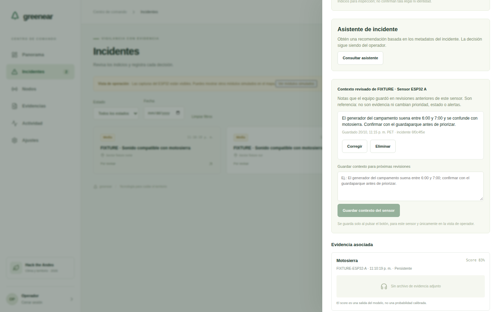
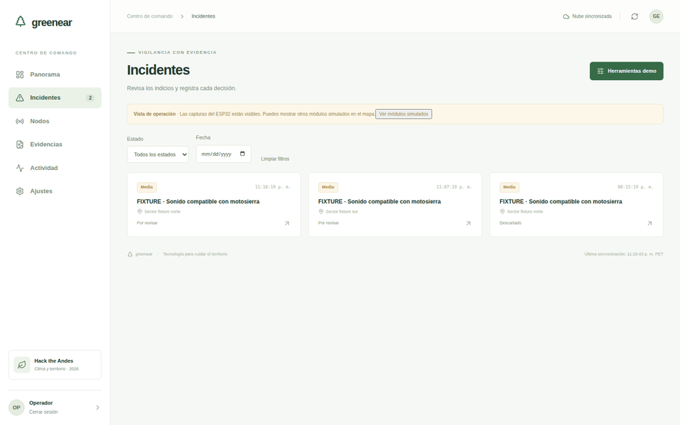

# Contexto revisado del sensor

La captura y la grabación muestran la aplicación real en localhost. Supabase y Atomic Memory usan proveedores HTTP de prueba con datos sintéticos identificados como FIXTURE. No demuestran llamadas al servicio de Atomic Memory ni detecciones reales.

La grabación muestra guardar una observación, recuperarla en otro incidente del mismo sensor, comprobar que otro sensor no la recibe, corregirla y eliminarla.

Para reproducir: `npm ci`, `npx tsx scripts/atomic-memory-fixture-demo.ts` y, en otra terminal, ejecutar el comando que imprime el script. Abrir `http://127.0.0.1:4601`, ingresar como operador con `fixture-demo` y abrir los incidentes sintéticos. No usar estas credenciales de prueba en producción.

[Video WebM](demo.webm)
